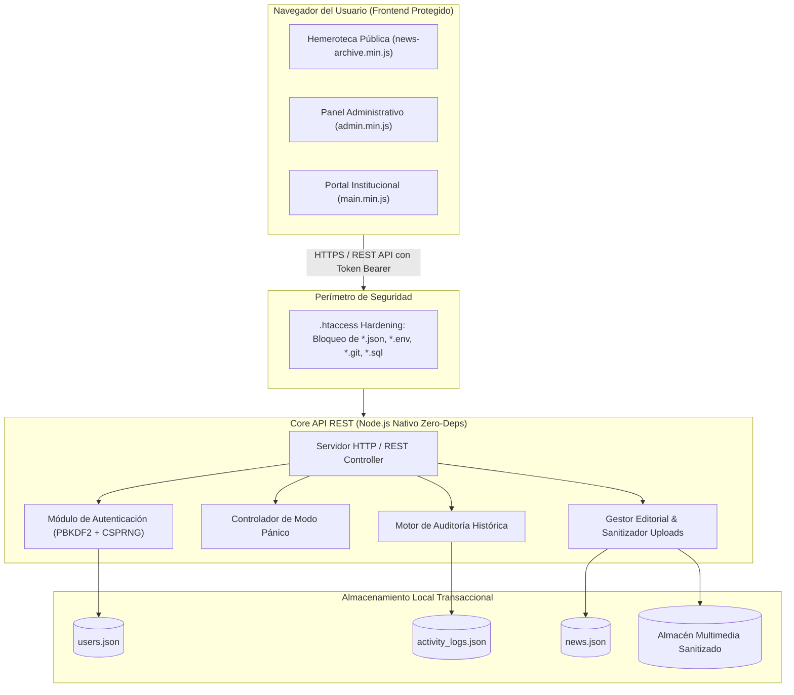

# 📰 Módulo Editorial y CMS de Noticias | Showcase Oficial

[-F59E0B?style=for-the-badge&logo=node.js)](https://lonetsolutions.com)

 

### 🌟 Plataforma Editorial, Sistema de Noticias y Hemeroteca Interactiva de Alta Seguridad
**Diseñado, construido y mantenido por [LoNet Solutions](https://lonetsolutions.com)**

[🚀 Panel Demo Interactivo](https://lonetsolutions.com/demo/) • [📰 Hemeroteca Demo](https://lonetsolutions.com/demo/noticias.html) • [🏫 Portal Escolar Demo](https://lonetsolutions.com/demo/portal.html) • [🌐 Producción Real](https://juanjosenietocartagena.edu.co/noticias.html) • [🏢 Visitar LoNet Solutions](https://lonetsolutions.com)

---

## 📌 Acerca de este Showcase

> [!IMPORTANT]
> Este repositorio es el **escaparate oficial y ficha técnica pública (*Showcase*)** del **Módulo Editorial y CMS de Noticias** desarrollado por **[LoNet Solutions](https://lonetsolutions.com)**.
> 
> El código fuente original, lógica de controladores y bases de datos son **propiedad intelectual privada y confidencial de LoNet Solutions** y se comercializan bajo acuerdos de licenciamiento a medida para colegios, universidades, corporaciones y medios de comunicación.

---

## 🎯 Caso de Éxito en Producción: I.E. Juan José Nieto

El sistema se encuentra **desplegado y operando exitosamente al 100%** como la plataforma editorial institucional de la **Institución Educativa Juan José Nieto** de Cartagena de Indias, Colombia:

- **Portal Web Oficial:** [https://juanjosenietocartagena.edu.co](https://juanjosenietocartagena.edu.co)
- **Hemeroteca Institucional en Vivo:** [https://juanjosenietocartagena.edu.co/noticias.html](https://juanjosenietocartagena.edu.co/noticias.html)
- **Panel Administrativo Editorial:** [https://juanjosenietocartagena.edu.co/admin/](https://juanjosenietocartagena.edu.co/admin/)

---

## 🌟 Módulos y Capacidades Destacadas

### 1. 👥 Control de Acceso Basado en Roles (RBAC) con Jerarquía Blindada
- **Super Administrador (LoNet Solutions):** Cuenta blindada e inmutable; control total de la base de datos, panel de auditoría global y generador criptográfico de contraseñas con despacho directo a correo institucional.
- **Administrador:** Gestión de redactores, autores y auditoría histórica acotada (blindaje de privacidad: no puede ver operaciones del Super Administrador).
- **Docente Autor / Redactor Senior:** Redacción de comunicados, galerías de fotos múltiples, videos y moderación pedagógica escolar.
- **Estudiante Autor:** Redactor estudiantil cuyas notas pasan automáticamente a estado *Borrador / Por Aprobar* antes de publicarse en la web.

### 2. 🚨 Protocolo de Modo Pánico y Mantenimiento Preventivo
- Interruptor de contingencia accesible para Super Admin y Admin.
- Al activarse:
  - Super Admin y Admin conservan permisos de edición y publicación.
  - Docentes y Estudiantes conmutan de inmediato a **Modo Solo Lectura** (no pueden alterar noticias ni subir archivos).
  - La web pública despliega una alerta institucional preventiva avisando de labores de mantenimiento.

### 3. 📋 Módulo de Auditoría y Control Histórico
- Bitácora inmutable en tiempo real de todas las acciones del sistema:
  - Inicios de sesión y salidas.
  - Creación, modificación y eliminación de noticias.
  - Modificación de usuarios, activación/desactivación y reseteo de claves.
  - Activaciones de Modo Pánico.
- Búsqueda interactiva y filtrado inteligente por rol y tipo de evento.

### 4. 🛡️ Seguridad Criptográfica Multicapa (Zero-Dependencies)
- **Cero dependencias externas en tiempo de ejecución:** Funciona en Node.js nativo puro (`http`, `crypto`, `fs`, `path`).
- **PBKDF2 + SHA-512:** Hasheo con 100.000 iteraciones y salt aleatorio de 128 bits.
- **Tokens CSPRNG:** Sesiones opacas de 256 bits generadas criptográficamente.
- **Cierre por Inactividad (30 Minutos):** Temporizador regresivo en vivo con advertencia modal para proteger equipos compartidos en salas de docentes o directivos.
- **Blindaje de Servidor:** Reglas perimetrales `.htaccess` que impiden la descarga de archivos `.json`, `.env` o código fuente.

### 5. 📱 Frontend Ofuscado y Responsive (Mobile First)
- **Terser 3-Pass:** Código minificado a caracteres únicos, de una sola línea y **100% libre de comentarios** para impedir la ingeniería inversa.
- **Inspección Sanitizada:** 0 comentarios en el DOM HTML para que nadie descubra nombres de modales o vistas internas.
- **Login Centrado en `100dvh`:** Adaptación perfecta en teléfonos y tablets sin desbordamientos de pantalla.

---

## 🏛️ Arquitectura del Sistema

---

## 🚀 Cómo Probar el Demo en Vivo (*Live Demo*)

Puedes experimentar la velocidad, el diseño responsive y todas las funcionalidades del sistema directamente en los entornos disponibles:

### 1. 🚀 Suite Demo Sandbox en Vivo (LoNet Solutions)
- **Panel Administrativo Editorial:** [https://lonetsolutions.com/demo/](https://lonetsolutions.com/demo/)
  - Acceso inmediato en 1 clic con 4 roles preconfigurados (**Super Admin**, **Administrador**, **Docente Autor**, **Estudiante Autor**).
  - Simulación completa de creación, edición, publicación, Modo Pánico y auditoría.
- **Hemeroteca Institucional Demo:** [https://lonetsolutions.com/demo/noticias.html](https://lonetsolutions.com/demo/noticias.html)
  - Visualización pública interactiva de las publicaciones creadas en el sandbox, buscador predictivo y galerías.
- **Portal Web Escolar Demo:** [https://lonetsolutions.com/demo/portal.html](https://lonetsolutions.com/demo/portal.html)
  - Réplica del portal institucional con cintillo breaking news, reproductor de himno y ventanilla PQRS.
- **Aislamiento Total:** Funciona en `localStorage` con botón para **Restablecer Datos Demo** en cualquier instante.

### 2. 📰 Hemeroteca Pública Institucional en Producción Real
- **Enlace Directo:** [https://juanjosenietocartagena.edu.co/noticias.html](https://juanjosenietocartagena.edu.co/noticias.html)
- Prueba en vivo el buscador predictivo en tiempo real, selector de categorías por filtros interactivos, cintillo dinámico de última hora (*Breaking News*) y lector modal con galería fotográfica y visor de video.

### 3. 🔐 Acceso al Panel Editorial Institucional Real
- **Enlace Directo:** [https://juanjosenietocartagena.edu.co/admin/](https://juanjosenietocartagena.edu.co/admin/)
- Observa la pantalla oficial de autenticación con blindaje criptográfico PBKDF2 y diseño adaptado con centrado dinámico en teléfonos y tablets.

### 🌐 Sección Showcase en el Sitio Web Corporativo
- Visita la sección dedicada de proyectos en: [https://lonetsolutions.com/#showcase](https://lonetsolutions.com/#showcase)

---

## 💼 Adquisición, Licenciamiento e Integraciones

¿Te gustaría implementar este sistema editorial, un CMS institucional a medida o una plataforma web de alto rendimiento para tu colegio, universidad, empresa o medio digital?

**LoNet Solutions** ofrece:
- Licenciamiento del software con personalización visual (colores, logotipos, módulos).
- Instalación y despliegue llave en mano en servidores cPanel, Hostinger, AWS o VPS Linux.
- Capacitación y manuales de usuario para el personal docente o editorial.
- Soporte técnico continuo y garantías de seguridad.

### Contacto Comercial Oficial:
- **Empresa:** [LoNet Solutions](https://lonetsolutions.com)
- **Sitio Web Oficial:** [https://lonetsolutions.com](https://lonetsolutions.com)
- **Correo Electrónico:** `solutionslonet@gmail.com`
- **WhatsApp Directo:** `+57 301 7686592`
- **Ubicación:** Cartagena de Indias, Colombia (cobertura en toda Colombia y Latinoamérica).

---

## 📄 Licencia

Este software es propiedad intelectual y comercial exclusiva de **[LoNet Solutions](https://lonetsolutions.com)**. Todos los derechos reservados. Para términos de uso o licencias comerciales, consulta el archivo [LICENSE](LICENSE).
